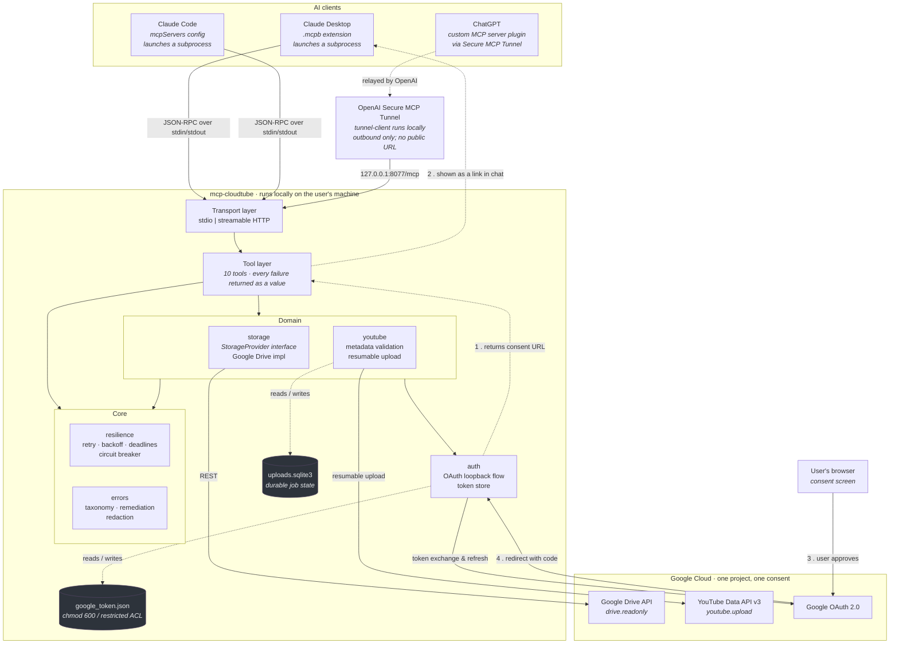
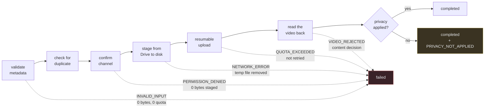

# Architecture

## The whole system



## The upload pipeline

Ordered cheapest-check-first, so the failures a user is most likely to hit
cost the least.



Each stage writes its outcome to the job record before moving on, so a crash
at any point leaves a job whose state is true rather than one stuck at
"uploading" forever.

## The auth flow

The constraint is that it must be driven from chat — no CLI step, and the
session must not block while the user finds their password.

```mermaid
sequenceDiagram
    actor User
    participant Client as Claude / ChatGPT
    participant Server as mcp-cloudtube
    participant Loop as loopback listener<br/>127.0.0.1:ephemeral
    participant Google

    User->>Client: "upload my demo to YouTube"
    Client->>Server: search_files(...)
    Server-->>Client: ok:false · AUTH_REQUIRED<br/>remediation: call connect_account
    Client->>Server: connect_account()
    Server->>Loop: bind an ephemeral port
    Server-->>Client: authorization_url  (returns at once)
    Client-->>User: "open this link to connect"

    User->>Google: approves in the browser
    Google->>Loop: redirect with code + state
    Loop->>Loop: compare state (constant-time)
    Loop->>Google: exchange code for tokens
    Google-->>Loop: access + refresh token
    Loop->>Loop: verify every scope was granted
    Loop-->>User: "Account connected" page

    User->>Client: "done"
    Client->>Server: search_files(...)
    Server-->>Client: ok:true · results
```

Why a loopback redirect rather than a hosted callback: it is what Google's
"Desktop app" client type is designed for, the whole exchange stays on the
user's machine, and no part of this project ever needs a public URL or a
client secret deployed anywhere.

The same reasoning drives the ChatGPT path. Its model runs on OpenAI's
servers, so `localhost` is unreachable from there — but rather than publish the
server behind a public tunnel, `tunnel-client` runs locally and dials *out*,
so the server stays bound to `127.0.0.1` and no inbound port is ever opened.

## Layering rule

Dependencies point one way:

```
tools  ->  domain (storage, youtube)  ->  core (resilience, errors)  ->  config
                     |
                     +->  auth
```

Nothing above `storage/` imports `googleapiclient`. That is what makes the
second storage provider a new module rather than edits at six call sites, and
it is why the Drive-specific awkwardness — native-document exports, `q`
expression escaping, shared-drive flags — stays in one file.
